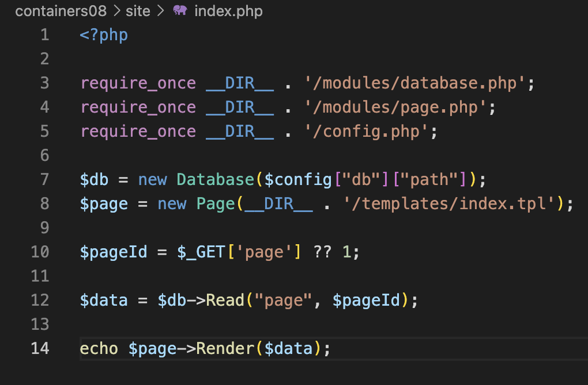
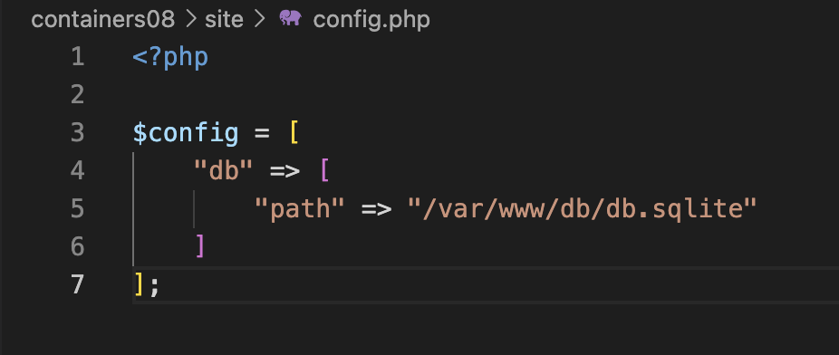
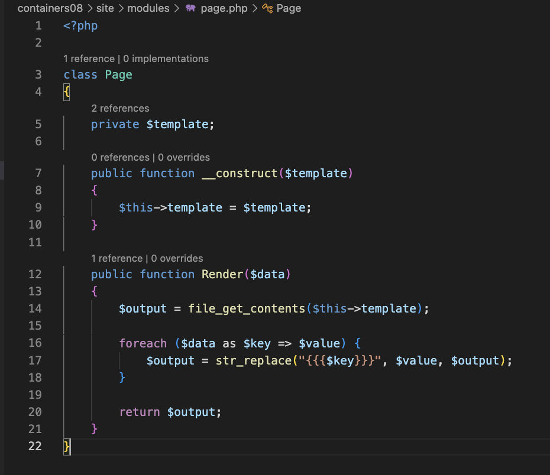
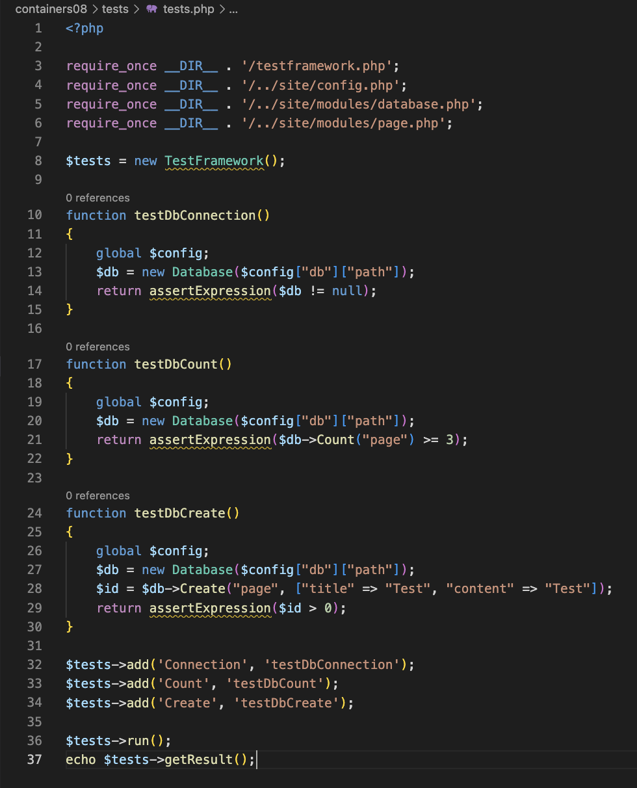
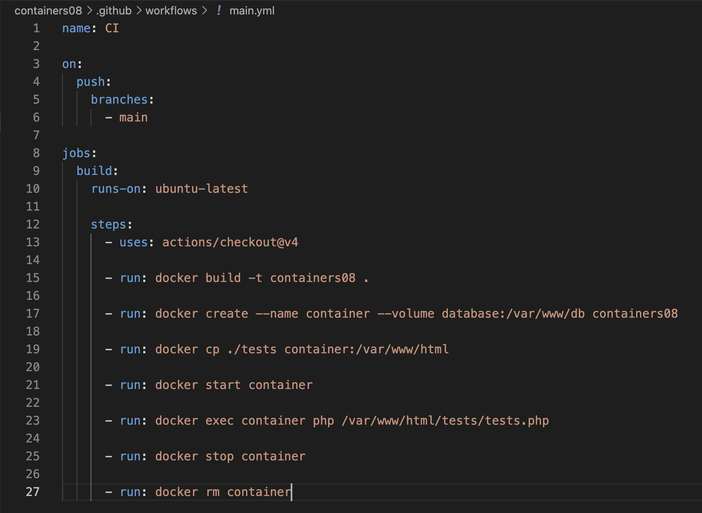
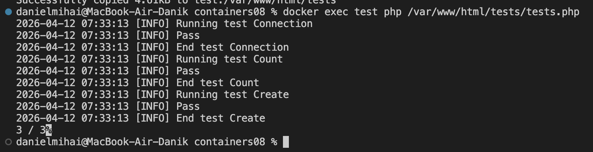

# Лабораторная работа №8

## Настройка непрерывной интеграции с использованием GitHub Actions

## Цель работы

Изучить процесс настройки непрерывной интеграции (CI) с использованием GitHub Actions, а также научиться тестировать приложение внутри Docker-контейнера.

## Задание

Создать Web-приложение на PHP, реализовать тесты для него и настроить автоматический запуск тестов с помощью GitHub Actions.

Требования:

* реализовать структуру PHP-приложения
* использовать SQLite для базы данных
* написать тесты для приложения
* создать Dockerfile
* настроить GitHub Actions для автоматического запуска тестов

## Ход выполнения работы

### 1. Создание структуры проекта

Создана структура проекта:

```id="s1"
containers08/
├── site/
├── sql/
├── tests/
├── Dockerfile
└── .github/workflows/main.yml
```

---

### 2. Реализация Web-приложения

Созданы основные файлы приложения:

* index.php
* config.php
* modules/database.php
* modules/page.php








---

### 3. Создание тестов

Создан тестовый фреймворк и набор тестов:

* tests/testframework.php
* tests/tests.php

Тестируются:

* подключение к базе данных
* подсчет записей
* создание записи



---

### 4. Dockerfile

Создан Dockerfile:

* установка SQLite
* создание базы данных
* копирование приложения

---

### 5. Настройка GitHub Actions

Создан файл:

```id="s2"
.github/workflows/main.yml
```

Основные шаги:

* сборка Docker-образа
* создание контейнера
* копирование тестов
* запуск тестов
* остановка контейнера



---

### 6. Запуск тестов

Тесты были успешно выполнены внутри контейнера:



Результат:

```id="s3"
3 / 3
```

---

## Ответы на вопросы

### 1. Что такое непрерывная интеграция?

Непрерывная интеграция (CI) — это процесс автоматического тестирования и сборки проекта при каждом изменении кода. Это позволяет быстро выявлять ошибки и поддерживать стабильность проекта.

### 2. Для чего нужны юнит-тесты? Как часто их нужно запускать?

Юнит-тесты используются для проверки корректности отдельных частей приложения.

Они должны запускаться:

* при каждом изменении кода
* при каждом коммите
* перед деплоем

---

### 3. Что нужно изменить, чтобы тесты запускались при Pull Request?

В файл main.yml нужно добавить:

```yaml id="s4"
on:
  push:
    branches:
      - main
  pull_request:
```

---

### 4. Что добавить для удаления образов после тестов?

Добавить шаг:

```yaml id="s5"
- run: docker rmi containers08
```

---

## Вывод

В ходе выполнения работы было разработано PHP-приложение с использованием SQLite, реализованы тесты и настроена система непрерывной интеграции с помощью GitHub Actions. Получены практические навыки работы с Docker, автоматизированным тестированием и CI/CD процессами.
